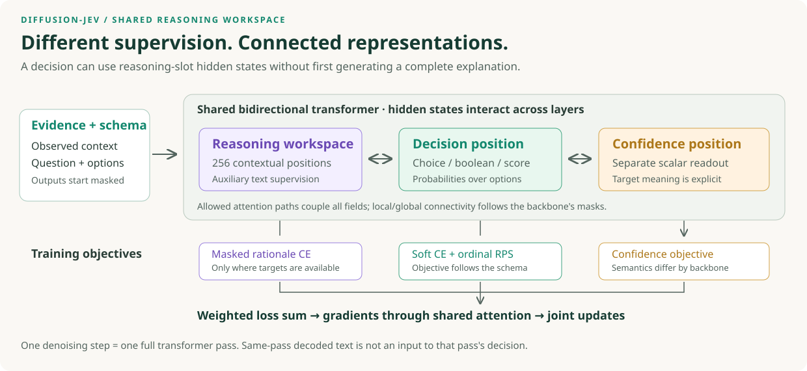
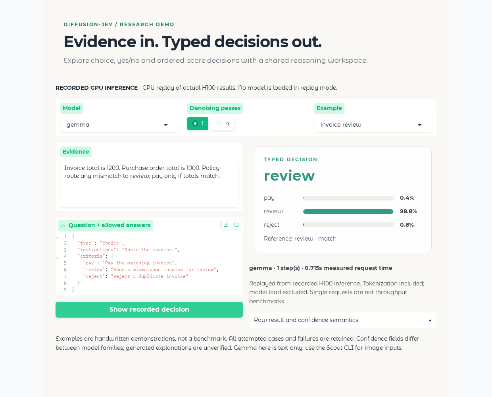
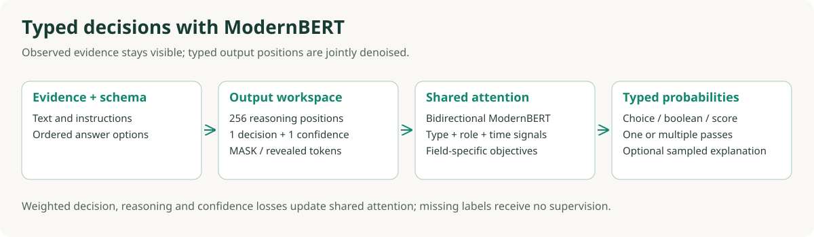

# diffusion-jev

**Train local, JEV-like decision models with explicit answer schemas and a shared denoising workspace.**

**Model weights are coming soon on Hugging Face.** Release links will be added here when
available; the code and reproducible training instructions are available now.

diffusion-jev turns evidence and a question into probabilities over **choices, booleans or ordered scores**.
It supports a compact Laya/ModernBERT branch, Scout's frozen visual connector, and a
Gemma 4 E4B text adapter with bidirectional attention. Separate objectives for decisions,
reasoning and confidence update shared representations.

This is an independent research toolkit, not an official implementation of AutoTrust JEV or
Cloudflare CLEF. There is no associated published paper or claim of general state of the art.

[Quick start](#quick-start) · [Train your model](docs/TRAINING.md) · [Method](docs/METHOD.md) ·
[Results](docs/RESULTS.md) · [Reproducibility](docs/REPRODUCIBILITY.md) · [Model cards](model_cards/README.md)

## The central idea

**Reasoning slots and decision slots share attention, while their losses supervise different
parts of the task.** A 256-position reasoning workspace sits beside the decision and
confidence positions. The model processes them together with the evidence and answer schema.
Across transformer layers, a decision can use contextual representations from the reasoning
workspace, and decision supervision can update parameters used to build those representations.



This design provides three useful capabilities:

- **Richer supervision:** verified rationale text can train the shared representation alongside
  the original decision targets. Missing rationale labels receive no text-supervision loss.
- **Explicit output semantics:** choices, ordered scores and confidence have appropriate
  objectives, while sharing the same context and attention computation.
- **A controllable inference budget:** one pass reads the decision from a masked workspace;
  additional passes can expose predicted workspace tokens before a later decision readout.

At one step, the interaction is between **hidden representations**. The answer cannot read
the discrete rationale tokens produced at the end of that same pass. The 256 extra positions
also cost memory and computation; they are not free inference-time reasoning.

Gradient tests verify the decision-to-workspace connection in both backbone families. The
saved accuracy comparisons evaluate complete systems; they do not yet isolate an accuracy
gain caused by reasoning tokens. [Mechanism, losses and the necessary ablations](docs/METHOD.md).

## Where the reasoning traces come from

For the original typed-decision experiment, reasoning traces were generated **offline by
Gemma 4 12B (`google/gemma-4-12B-it`) for training supervision**. The teacher produced a short
explanation and an answer label. After format, length and label-agreement checks, **3,284 of
4,800 training decisions** received accepted explanations. All decisions retained their
original targets, including cases without an accepted trace.

These traces supervise masked reasoning positions in the 256-slot workspace; the original
data supervises the decision. The teacher is not called during student inference, and gold
traces are not supplied as evaluation inputs. They are generated explanations, not extracted
teacher hidden states or guaranteed faithful accounts of its reasoning.

Later mixtures also used source-provided explanations, such as ScienceQA solutions; not all
traces across all experiments were Gemma-generated. Optional CLEF distillation supplies
**answer distributions**, a separate signal from reasoning text. The 12B explanation teacher
is also distinct from Titan's Gemma 4 E4B student backbone.
[Trace preparation and supervision details](docs/METHOD.md#reasoning-trace-provenance).

## See it work



The GIF is a browser recording of the Gradio **replay** interface displaying actual H100
inference. It is not a live speed demonstration. All 48 attempted predictions, including
ModernBERT and Scout failures, are included in [demo records](assets/demo_records.json), with
[checkpoint hashes and hardware provenance](assets/demo_provenance.json).
Eight handwritten examples × two pass counts × three models are **not a benchmark**.

The app also runs live inference when a local checkpoint is supplied. It never substitutes
a recorded result for an arbitrary live request.

## What is included

| Variant | Backbone / conditioning | Training | Inference |
|---|---|---|---|
| ModernBERT diffusion | Laya/ModernBERT; text | Shared masked-field objective; full student updates | One or multiple stochastic denoising passes |
| Scout | ModernBERT + frozen SigLIP + learned connector | Same typed objective; image features join attention | Text or image-conditioned decisions |
| Titan (internal Gemma variant) | Gemma **4 E4B** text backbone | Frozen base, LoRA, learned slots/readout; optional offline teacher distributions | Deterministic one-pass readout or workspace reveal before final readout |

Gemma E4B is not “Gemma 3 4B.” Our loaded text-plus-adapter model has about **7.54B total
parameters and 77.0M trainable parameters**. Its separate native image/audio towers are not
part of this adapter. All branches use one question per example, up to 64 answer options.

**One step or eight?** This is configurable, and the model families differ. Historical
ModernBERT results used eight steps and two trajectories. The main matched Gemma results
use one pass; its four-pass diagnostic reveals workspace tokens before a final decision.
Training samples a noise level and takes one denoising forward/backward pass per batch;
it does not backpropagate through an eight-step inference rollout.



The diagram describes the ModernBERT branch. See [the method](docs/METHOD.md)
for the different Gemma confidence objective, reveal schedule, and later experiments.

## Quick start

Python 3.10 is tested. Install in an isolated environment; choose a PyTorch build appropriate
for your GPU driver. The recorded GPU runs used Torch 2.8.0+cu128 and Transformers 5.12.1.

```bash
git clone https://github.com/Shaurya026/diffusion-jev.git
cd diffusion-jev
python -m venv .venv
source .venv/bin/activate
pip install -e '.[demo,dev]'
python app.py
```

Open `http://127.0.0.1:7860`. Default replay mode works on CPU and needs no model download.

For a real local checkpoint:

```bash
python -m diffusion_jev.predict \
  --family modernbert --checkpoint checkpoints/diffusion-jev-modernbert \
  --input examples/request.json --device cuda --steps 1

python app.py --family modernbert \
  --checkpoint checkpoints/diffusion-jev-modernbert --device cuda
```

The checkpoint directory above is a **local destination**, not an already published model.
Weights are coming soon on Hugging Face and have not been uploaded yet.
[Model cards](model_cards/README.md) explain formats and
dependencies; the [export tool](scripts/export_checkpoint.py) stages weights without uploading.

For the Gemma adapter, also provide the separately downloaded, pinned base:

```bash
hf download google/gemma-4-E4B-it \
  --revision ee0ef6023621cff504d758262d4e04895a5af4a2 \
  --local-dir checkpoints/gemma-base
python app.py --family gemma --checkpoint checkpoints/titan-gemma \
  --base checkpoints/gemma-base --device cuda
```

## Train your own model

The portable path is deliberately short:

1. Write JSONL with evidence, a question, an answer distribution, and a case/group ID.
2. Prepare and audit splits/token budgets with `diffusion-jev-prepare`.
3. Run `diffusion-jev-train` on CPU, one GPU or `torchrun` DDP.
4. Evaluate the validation-selected checkpoint with `diffusion-jev-evaluate`.

```json
{"id":"case-1:q1","group":"case-1","split":"train","state":"Two identical charges appear on the invoice.","question":{"type":"choice","instructions":"Choose a team.","criteria":{"billing":"Charges and refunds","technical":"Software faults"}},"target":{"billing":0.95,"technical":0.05}}
```

Optional `rationale` contains **training-only** explanation text. Optional `confidence`
supplies the legacy ModernBERT confidence target; absent targets receive no confidence loss.
Gemma instead learns the target probability mass of its selected option. Do not mix these
confidence meanings. See [the complete training tutorial](docs/TRAINING.md), including a
pinned public-data recipe, checkpoint initialization, DDP, evaluation and restart commands.

## Measured comparisons

These are **saved local evaluations**, not model-card numbers. Each column compares the
same source-specific test inputs, ordered answer keys and target-mode labels.

| Model | Typed (2,000) | Few-shot episodes (712) | ScienceQA text (200) |
|---|---:|---:|---:|
| Gemma diffusion, 5-epoch selected checkpoint | **79.10** | 71.63 | 92.50 |
| Cloudflare CLEF | 71.10 | **80.34** | **97.00** |
| AutoTrust JEV-27B-VL | 58.05 | 76.83 | 95.00 |

Percent accuracy. No pooled overall score is reported. The student trained on related task
families; this is not a comparison of equal pretraining or equal compute. CLEF leads on the
few-shot cohort. Historical checkpoints are not claimed to have trained exclusively on the
public recipe distributed here.

**Evidence limit:** repeated historical evaluations of identical Gemma adapter bytes changed
predictions; the cause remains unresolved. Small differences across saved Gemma runs are not
established training gains. [Full source-specific scores and caveats](docs/RESULTS.md).

Laya and early Scout used other evaluation protocols. Their available source-specific scores
remain in a [separate table](results/historical_cohorts.csv). Later contrastive-loss experiments
are reported as ablations, distinguishing final from validation-selected checkpoints.

## Repository map

```text
diffusion_jev/
  modernbert/       # shared denoiser, typed losses, tokenization, checkpoints
  gemma/            # bidirectional Gemma + LoRA, slot objective, readout
  vision/           # frozen-feature connector and Scout checkpoint loader
  runtime.py        # DecisionEngine: one inference API, no gold inputs
  prepare.py        # group-safe partitions and token-budget checks
  train.py          # reference trainer, validation selection, DDP, resume
  evaluate.py       # independent ground-truth scoring
app.py              # Gradio replay or live local inference
configs/            # documented training presets
examples/           # small original demonstration cases
scripts/            # pinned data fetch, comparison, local export, recording
results/            # measured aggregate tables with cohort boundaries
docs/               # method, training, evaluation and reproduction details
tests/              # leakage, attention, gradients, checkpoints and data contracts
```

The portable trainer is a new, readable reference recipe using the trained model/loss code.
It is not a byte-identical replay of every historical cluster script. Exact historical
mixtures include local data not bundled here. [Reproducibility scope](docs/REPRODUCIBILITY.md)
states what is executable, what needs checkpoint/data artifacts, and what remains unverified.

## Tests and attribution

The [release validation report](docs/VALIDATION.md) records the CPU tests, pinned data
preparation, H100 inference and browser checks actually completed for this distribution.

```bash
USE_TF=0 OMP_NUM_THREADS=1 pytest -q
ruff check diffusion_jev scripts tests --select E9,F63,F7,F82,F401,F811
python -m compileall -q diffusion_jev tests
```

Code: Apache-2.0; see [LICENSE](LICENSE), [NOTICE](NOTICE) and
[source provenance](third_party/source-provenance.json). Dataset/model terms remain source-specific.
This repository owes its initialization and schema machinery to
[Laya](https://github.com/NandhaKishorM/laya), and compares against
[JEV-27B-VL](https://huggingface.co/autotrust/JEV-27B-VL) and
[CLEF](https://huggingface.co/Cloudflare/clef). The presentation structure takes inspiration
from [WS-DAN.PyTorch](https://github.com/GuYuc/WS-DAN.PyTorch); its code is not copied here.

See [METHOD.md](docs/METHOD.md) for primary references. `CITATION.cff` describes this software;
no paper title, publication venue, DOI or public repository address is invented.
