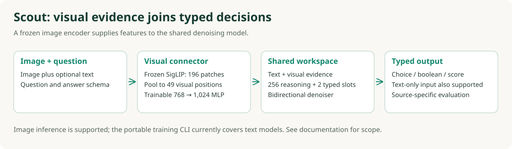

# Method and model families

The task is conditional distribution prediction. Given evidence `x`, a question and its
allowed options, return probabilities aligned with those option keys. Ordered scores use
the order supplied by the schema. One record is one question; case IDs control split groups.

## Why a shared reasoning workspace?

The core design combines **shared computation with separate supervision**. Evidence and the
answer schema condition a sequence containing 256 reasoning positions, a decision position
and a confidence position. Bidirectional attention connects their hidden representations
where the architecture's attention mask permits it. Titan is the internal name for the
Gemma adaptation of this design; the repository and method are named **diffusion-jev**.


A decision query attends to keys and values from the permitted evidence and workspace
positions. At later layers, those workspace representations already contain contextual
information from earlier layers. The decision therefore need not be computed from an isolated
classification token. The reasoning positions can participate even when their input tokens
are all masked. One denoising step contains the entire transformer stack, not one attention
layer or 256 sequential generation steps.

For trainable shared parameters `θ`, the combined gradient has the form:

```text
L = λdecision Ldecision + λreason Lreason + λconfidence Lconfidence + optional terms
∇θ L = λdecision ∇θ Ldecision + λreason ∇θ Lreason + λconfidence ∇θ Lconfidence + ...
```

Separate loss functions do not isolate the token groups. For example, decision loss can
differentiate through attention values originating in reasoning positions. Rationale loss
also updates shared trainable parameters used to construct decision representations. In the
Gemma branch, gradients train LoRA and workspace/readout parameters while base weights stay
frozen. The losses themselves do not pass messages to each other: their gradients combine
on the shared computation graph. These gradients can reinforce or conflict with each other,
which is why loss weights and label quality matter.

This makes verified rationale annotations useful as an **auxiliary training signal** without
requiring a complete autoregressive explanation before every decision. It does not ensure
that every slot is used effectively or that generated text faithfully explains the answer.
The original decision distribution remains the decision target; teacher text does not
replace it. Supervision eligibility and confidence semantics are explicit rather than inferred
from the existence of a token position.

## One step versus multiple steps

| Budget | What can influence the decision? | Interpretation |
|---|---|---|
| One pass | Evidence, schema and contextual hidden states of masked output positions | Shared latent computation; no previously generated discrete rationale |
| Multiple passes | The above plus output tokens revealed on earlier passes | Iterative conditioning; reveal policies differ by backbone |

Tokens decoded at the end of a pass cannot retroactively influence that pass's decision.
With several passes, previously revealed tokens become inputs to a later pass. ModernBERT
may reveal its decision before all reasoning slots, whereas Gemma keeps its decision hidden
until its final readout. More passes therefore change the computation and cost, but do not
guarantee a better answer. The 256-slot workspace is a chosen capacity, not a measured optimum.

## Objectives follow the schema

| Supervised field | Objective | Why it is distinct |
|---|---|---|
| Categorical choice | Soft-target cross-entropy | Preserve the supplied probability distribution over allowed answers |
| Boolean decision | Two-class cross-entropy, equivalent to Bernoulli CE | Same probabilistic target with two outcomes |
| Ordered score | Soft CE plus ranked probability score (RPS) | Penalize cumulative-distribution errors that respect category order |
| Reasoning text | Masked token CE where verified targets exist | Auxiliary representation learning from training-only explanations |
| Confidence | Backbone-specific objective, described below | Its target must have a defined meaning, not just be a number in [0,1] |

Masks decide which fields are observed, predicted and supervised; weights set their relative
contribution. Sequence padding is excluded from attention keys. Padding within the reasoning
workspace follows each model's label-weight policy and is not additional explanation text.

## Reasoning-trace provenance

The original typed-decision data provides decision targets, not explanation text. Its
reasoning annotations were generated offline with **`google/gemma-4-12B-it`**, using the
local teacher snapshot `0e2b1058541244490925fbacf8972041435691ac`. This 12B explanation
teacher is separate from the Gemma 4 E4B backbone adapted into the Titan student.

The original annotation procedure was:

1. Split the data first. Annotate training decisions only, using the context visible to the
   student and two same-question-type demonstrations from other training cases. The current
   case's gold answer and confidence are withheld from the teacher prompt.
2. Ask the teacher for a short explanation and one allowed answer label in structured JSON.
3. Accept valid explanations of 4–255 student-tokenizer tokens with no reserved tokens,
   requiring the teacher's label to agree with the original dataset label. Reserve the
   remaining workspace position for the explanation end marker.
4. Attach accepted text as a separate training target. Preserve the original decision
   distribution and confidence annotation. Keep rejected cases for decision supervision.

This yielded **3,284 accepted explanations among 4,800 training decisions**. Label agreement
and format checks are admission filters, not proof that an explanation is correct or faithful.
Agreement filtering also favors examples the teacher already handles well; coverage matters.
These are teacher-generated textual explanations, not access to internal teacher states.

Later training mixtures reused accepted Gemma annotations and also included source-provided
explanations, including ScienceQA training solutions. Thus the original typed-only traces
were Gemma-generated, but that description is not exclusive across every later experiment.
Explanations are retokenized for the student and checked against its workspace budget.

Accepted text supplies masked rationale CE; decision targets continue to supply decision
losses. Missing rationale labels receive no text-supervision loss, while the shared workspace
can still receive decision gradients. During evaluation and deployment, no gold rationale is
provided and the student does not call the 12B teacher. Generated student explanations are
not guaranteed faithful. CLEF's optional offline **probability-distribution** targets are a
different distillation signal and should not be described as Gemma reasoning traces.

The portable preparation CLI accepts your verified `rationale` field; it does not generate
teacher annotations or bundle the historical teacher cache. Keep annotation provenance and
filtering audits with your own training data when reproducing this supervision strategy.

## ModernBERT: a jointly attended output canvas

Laya formats instructions, option markers/descriptions and state. We append 256 reasoning
positions, a decision token and a confidence-bin token. The ModernBERT encoder and task head
are bidirectional. Role, question-type and time embeddings distinguish output fields and
noise levels. A dynamic option scorer uses the decision and option-marker representations.

During training, draw a noise level and mask output positions. Evidence stays observed.
The original soft target supplies the decision loss; a clean decision token, when revealed,
is sampled from that target. Accepted rationale text supervises reasoning. Missing rationales
do not acquire invented text labels. The portable trainer masks unannotated confidence inputs
and disables their loss.

```
L = L_choice + L_boolean + L_score_CE + 0.5 L_score_RPS
    + 0.1 L_reasoning_CE + 0.1 (L_confidence_bin_CE + L_confidence_MSE)
```

Choice/boolean/score terms apply to their respective question types. Mask eligibility,
diffusion-time weighting and per-example normalization are implemented in
`modernbert/process.py`; this is a task-weighted denoising objective, not an exact joint
likelihood bound. RPS compares cumulative distributions over ordered categories.

At inference, all outputs begin masked. Each step predicts from the currently visible
canvas, then reveals some unknown positions. A decision can be revealed before all reasoning
positions; its posterior is recorded before exposing its sampled answer token. Revealed tokens
are not revised. Multiple trajectories average recorded decision probabilities.

At **one step**, reasoning and answer are predicted from masked positions together. The answer
cannot condition on the discrete explanation tokens produced in that same pass. There is
still interaction among their hidden representations through attention.

## Scout: add frozen visual features



Frozen SigLIP produces 196 patch vectors at 224-pixel resolution. Pool to a 7×7 grid and map
each 768-dimensional vector to the 1,024-dimensional text space using a trainable MLP. Insert
these 49 positions before the text and shift the output/marker positions. Text-only inputs
retain their layout. The historical context limit is 1,536 positions including outputs.

The standalone Scout loader accepts text and images. The portable reference trainer currently
covers **text ModernBERT and Gemma**; it does not advertise image-training reproduction through
the text JSONL CLI. Reproducing the historical visual run also needs image grouping, pinned
SigLIP features and its source sampler; see the historical recipe table in REPRODUCIBILITY.md.

## Gemma 4 E4B: adapt an autoregressive backbone

The Gemma branch is independently initialized from `google/gemma-4-E4B-it`, revision
`ee0ef6023621cff504d758262d4e04895a5af4a2`. It does not grow ModernBERT weights into Gemma.
The loader strictly restores text weights, retaining native per-layer embeddings and shared
KV behavior while excluding the official loader's unused shared-KV projection tensors.

Frozen BF16 base weights are augmented by rank-32, alpha-64 LoRA on available Q/K/V/O and
gate/up/down projections, 258 learned output-slot embeddings, a time projection, and a
21-bin confidence head. Explicit attention masks make global layers bidirectional and local
layers symmetric while excluding padded keys. The choice head uses the pretrained token
projection restricted to 64 single-token option letters.

```
L = choice soft CE + 0.5 teacher KL + 0.5 ordinal RPS
    + 0.1 selected-option confidence Brier + 0.1 masked rationale CE
```

Half of training draws hide all output slots. Other draws hide a randomly selected fraction;
confidence stays hidden. Confidence targets the gold probability mass assigned to the model's
selected option. This differs from the legacy probability-margin field. Teacher KL is eligible
only for fully masked outputs and verified training teacher distributions. Rationale CE uses
only accepted text and bounded token subsampling to control the large vocabulary projection.

The public text-data recipe does **not** manufacture a teacher cache: without one, the teacher
weight is zero. Historical CLEF distillation used checked request hashes and aligned keys;
matching it requires that separate cache and quality gates.

One-pass Gemma inference reads the choice and confidence directly from the fully masked canvas.
For multiple passes, deterministic slices of workspace tokens are revealed between passes;
the choice and confidence stay masked for the final readout. Four passes reveal the first
192 workspace positions before the final readout. This is not the earlier stochastic
ModernBERT decision-reveal policy, nor a conventional autoregressive explanation generator.

## Contrastive branch: reported ablation

Later CLM-inspired experiments add normalized state/action projections, a bounded residual
compatibility score and forward/reverse contrastive objectives. They are not a reproduction
of released CLM weights. The historical result table includes them, but this first portable
release serves the three core model formats above; CLM adapter loading/training is not
silently mapped to plain Gemma. The final 30-epoch endpoint and validation-selected checkpoint
must be distinguished; the latter retained the parent in the saved results.

## What the evidence supports

The implementation tests verify an actual computational connection, not just an architectural
diagram. [ModernBERT's test](../tests/test_modernbert.py) backpropagates only the decision losses
and checks a nonzero gradient in the reasoning-role embedding. [Gemma's test](../tests/test_gemma.py)
backpropagates only choice CE and checks gradients in the 256 reasoning-slot embeddings.
Additional checks cover bidirectional visibility, padding isolation and exclusion of gold
rationales/targets from inference. These are mechanism checks, not benchmark improvements.

The [saved comparisons](RESULTS.md) evaluate the complete trained systems, including their
initialization, supervision and inference settings. They are useful empirical results but
cannot identify the causal contribution of workspace tokens alone. To support that claim,
run controlled experiments with identical data partitions, initialization, optimization and
validation-based checkpoint selection:

| Comparison | What it would isolate |
|---|---|
| Same 256 slots, rationale loss on versus off | Benefit of rationale supervision beyond extra positions |
| Shared attention versus explicitly isolated reasoning/decision blocks | Benefit of communication between token groups; avoid indirect evidence-mediated paths in the isolated control |
| 0 / 64 / 128 / 256 reasoning positions, retrained from matched initialization | Capacity–accuracy–memory tradeoff; report the changed compute budget |
| Same checkpoint at 1 / 2 / 4 / 8 passes | Test-time reveal benefit versus added latency; use each family's documented policy |

These are proposed experiments, not completed ablations or supported CLI switches for every
variant. Report accuracy and proper scores, latency, peak memory, repeated seeds and matched
example-level comparisons. Include confidence calibration rather than assuming the confidence
head is calibrated. Keep the unresolved historical Gemma evaluation discrepancy visible.

## References

- [Laya](https://github.com/NandhaKishorM/laya): initial typed-decision architecture and schema construction.
- [MDLM](https://arxiv.org/abs/2406.07524): masked diffusion language modeling.
- [LLaDA](https://arxiv.org/abs/2502.09992): diffusion language-model training at scale.
- [AR-to-diffusion adaptation](https://arxiv.org/abs/2410.17891): motivation for pretrained AR initialization.
- [LoRA](https://arxiv.org/abs/2106.09685): low-rank adaptation.
- [SigLIP](https://arxiv.org/abs/2303.15343): the frozen image representation.
- [LLaVA](https://arxiv.org/abs/2304.08485): a simple visual connector as a useful design reference.
- [JEV-27B-VL](https://huggingface.co/autotrust/JEV-27B-VL), [CLEF](https://huggingface.co/Cloudflare/clef): external typed-decision comparators.
- [CLM](https://github.com/Contrastive-LM/CLM): reference for the later compatibility-scoring ablation.

These references motivate individual design choices. We do not claim to reproduce their
training scale, architectures, benchmark results or guarantees. Normalizing flows and
one-step distillation were reviewed alternatives, not implemented by renaming this sampler.
